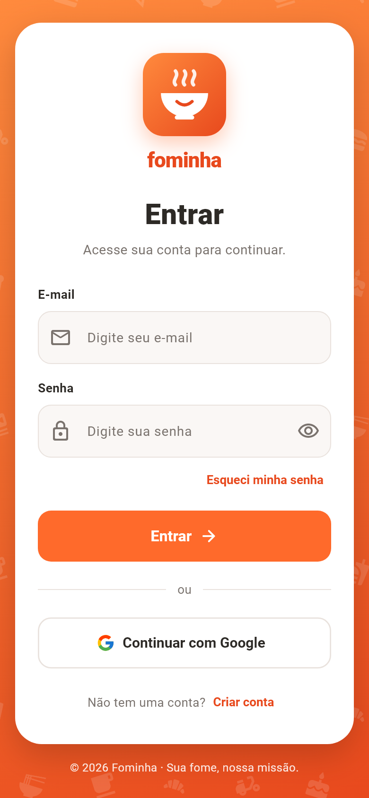
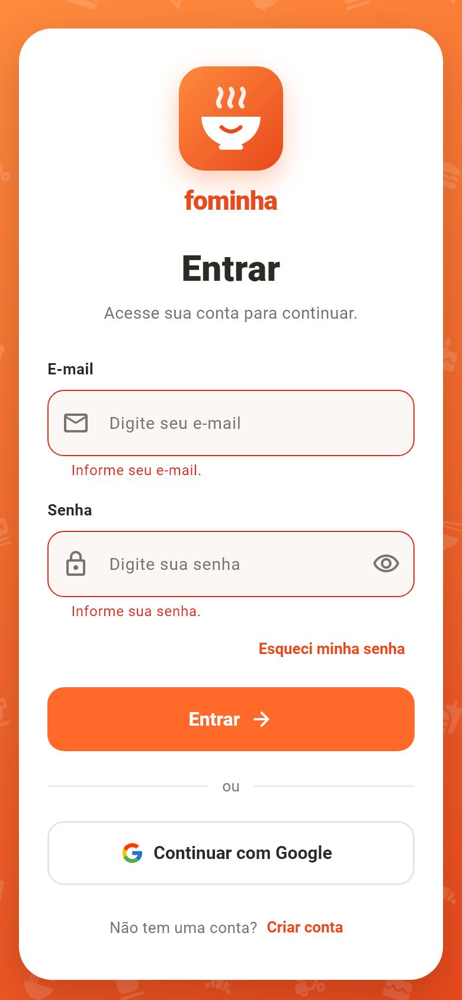
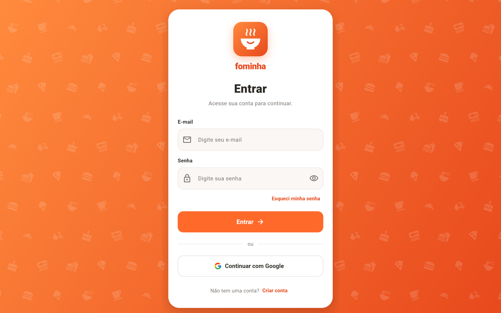

# Fominha — Aplicativo Delivery (Flutter)

**2ª entrega: Tela de login.** Somente interface, sem backend.

| Celular | Validação dos campos |
|---------|----------------------|
|  |  |



## O que foi feito

**1 - Layout conforme o esboço**, na mesma ordem: marca, título "Entrar",
subtítulo, campos "E-mail" e "Senha" com rótulo, "Esqueci minha senha",
botão "Entrar", divisor "ou", "Continuar com Google" e
"Não tem uma conta? Criar conta".

**2 - Personalização (identidade da marca *Fominha*)**

- **Marca:** logo próprio em SVG (tigela sorrindo com vapor) no lugar do
  quadrado "Marca", com o nome logo abaixo.
- **Cores:** paleta laranja/vermelho de delivery, com degradê no fundo.
- **Ícones:** estampa de comidas no fundo (pizza, hambúrguer, sorvete,
  lámen, café, moto de entrega...), ícones nos campos, botão de
  mostrar/ocultar senha e seta no botão "Entrar".
- **Imagens:** `assets/images/logo_fominha.svg` e `assets/images/google_g.svg`.
- Nome "Fominha" também no ícone do app (Android, iOS e Web).

**Sem backend.** Os botões só mostram mensagens (SnackBar). O "Entrar" valida
os campos (e-mail válido, senha com 6+ caracteres) e simula um carregamento.

O layout funciona do celular ao navegador: o cartão tem largura máxima de
420 px e a tela rola em aparelhos pequenos.

## Estrutura

```
lib/
├─ main.dart                   # MaterialApp e tema
├─ theme/app_tema.dart         # nome da marca, cores e tema
├─ widgets/fundo_comidas.dart  # fundo laranja com estampa de ícones
├─ widgets/logo_marca.dart     # logo + nome da marca
└─ screens/login_screen.dart   # tela de login
assets/images/                 # logo e ícone do Google (SVG)
```

Para trocar o nome da marca, basta alterar `AppMarca.nome` em
`lib/theme/app_tema.dart`.

## Como executar

```bash
flutter pub get
flutter run
flutter test
```

Dependência extra: [`flutter_svg`](https://pub.dev/packages/flutter_svg), usada para exibir as imagens SVG.
